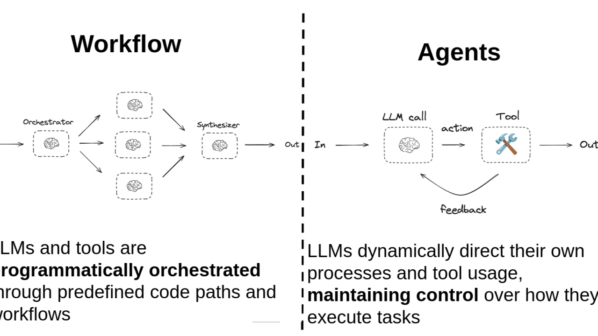

Building effective AI agents isn't about how complex you can make the system — it's about how simple you can keep it.

What I'm seeing across serious enterprise deployments is consistent: **the “winners” aren't betting on magic frameworks**. They're using **simple, composable patterns** and only adding autonomy when the data shows it improves outcomes.

Here's the high-level breakdown for leaders navigating the *agentic* shift.

## Know the difference: AI workflows vs agents

Most teams mix these up — and that's where ROI gets fuzzy.

- **Workflows**: predefined code paths. Use these for predictable, repeatable tasks where consistency is king (think: automated refund processing).
- **Agents**: the model dynamically decides what to do next and which tools to use in a loop. Use these for open-ended problems where the path isn't fixed (think: complex research, coding assistants).

**Strategy tip:** Don't build an agent if a workflow will do. Workflows are cheaper, faster, and easier to control. (This is also how you keep cost and latency sane.)

## The five design patterns (think “management styles” for your AI)

These patterns show up repeatedly in real systems because they're practical and scalable:

1. **Prompt chaining**: break work into sequential steps
2. **Routing**: classify and send to the right specialist
3. **Parallelization**: multiple attempts/subtasks in parallel for speed/coverage
4. **Orchestrator → workers**: a “manager” delegates to “workers”
5. **Evaluator → optimizer**: create → critique → improve (ideal for high-stakes outputs)

## The 3 golden rules for executive oversight

If your engineering team is building agents, I'd pressure-test these:

- **Maintain simplicity:** if you can't explain the agent's logic, it's too complex.
- **Prioritize transparency:** the system should show planning/steps to create an audit trail for trust.
- **Focus on the interface to tools (ACI):** agents fail less because “the model is weak” and more because tools, permissions, and documentation are messy. Clean tool contracts = reliable automation.

## One shift that will matter at board level: standardizing tool connectivity

As agents move from “demo” to “production,” **how they connect to enterprise tools becomes strategic**. That's why standards like **Model Context Protocol (MCP)** and the new **Agentic AI Foundation** under the **Linux Foundation** are worth watching — they push interoperability and governance forward.

## The bottom line

In the rush to “automate everything,” the winners won't be the ones with the most autonomous agents. They'll be the ones who build **predictable systems** that trade off autonomy for performance *where it counts*.

**Start small. Measure often. Only add complexity when the data demands it.**

## Sources

- [Agentic AI Foundation](https://aaif.io/)
- [Spring AI: Building effective agents](https://docs.spring.io/spring-ai/reference/2.0/api/effective-agents.html)
- [Anthropic: Building effective agents](https://www.anthropic.com/engineering/building-effective-agents)
- [Model Context Protocol: Introduction](https://modelcontextprotocol.io/docs/getting-started/intro)
- [Quarkus: Agentic AI with Quarkus, part 3](https://quarkus.io/blog/agentic-ai-with-quarkus-p3/)
